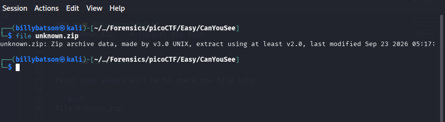
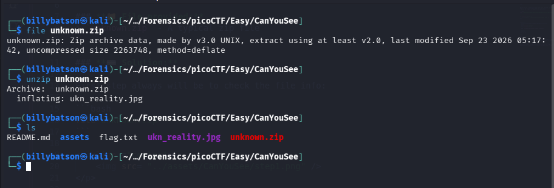
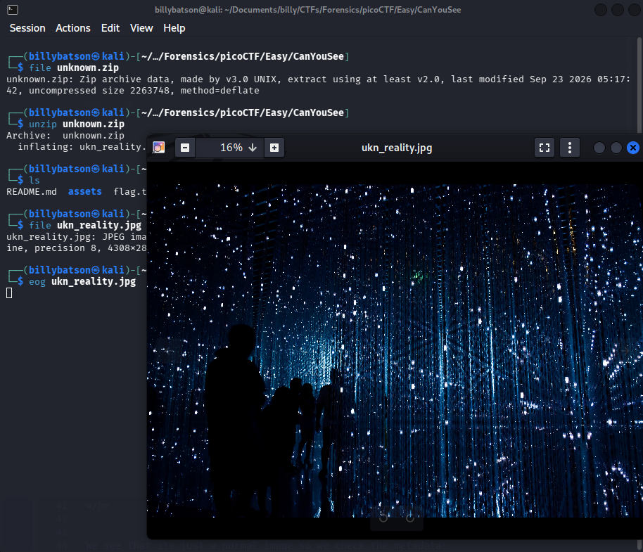
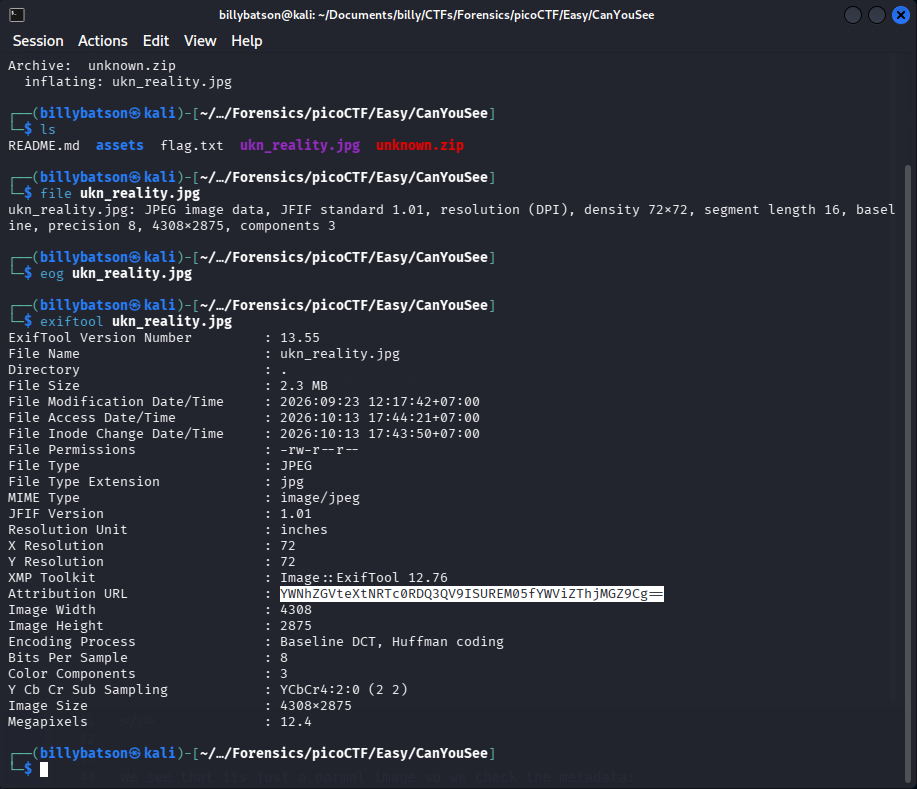
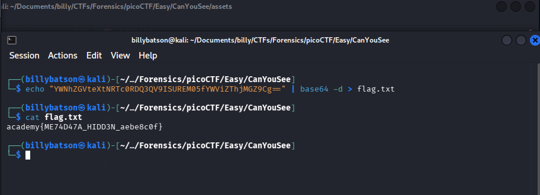

# CanYouSee

### **📝 Task:** 
> How about some hide and seek?


### **📁 File provided:**
* `unknown.zip` - A typical zip file


### **⌨️ Solution:**

First step always will be to check the file info:

```bash
file unknown.zip
```

<p align ="center">
    
</p>

It's a normal zip file so we just decompress it like normal 

```bash
unzip unknown.zip 
```

<p align ="center">
    
</p>

We get a .jpg image, we'll view it to see if its worthwhile:

```bash
eog ukn_reality.jpg
```

<p align ="center">
    
</p>


We see that its just a normal image so we check the metadata: 

```bash
exiftool extract
```

<p align ="center">
    
</p>


Which we see a familiar data type here, base64, we'll decode it and see that it is a flag so we create a flag.txt and put it in: 

```bash
echo "YWNhZGVteXtNRTc0RDQ3QV9ISUREM05fYWViZThjMGZ9Cg==" | base64 -d > flag.txt
```

<p align ="center">
    
</p>


<details>
  <summary>Click to reveal spoiler</summary>
  <br>
  <div align="center">

  ### `academy{ME74D47A_HIDD3N_aebe8c0f}`

  </div>
</details>

---

### **💡 Key takeaways:**

Always check the metadata of media files (images, audio, video) using tools like exiftool. Authors love to hide flags or hints in the comments, copyright, or author tags.

Get comfortable recognizing Base64 encoded strings. They typically contain alphanumeric characters and often end with one or two = padding characters.