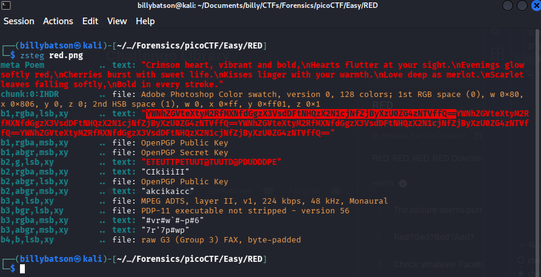
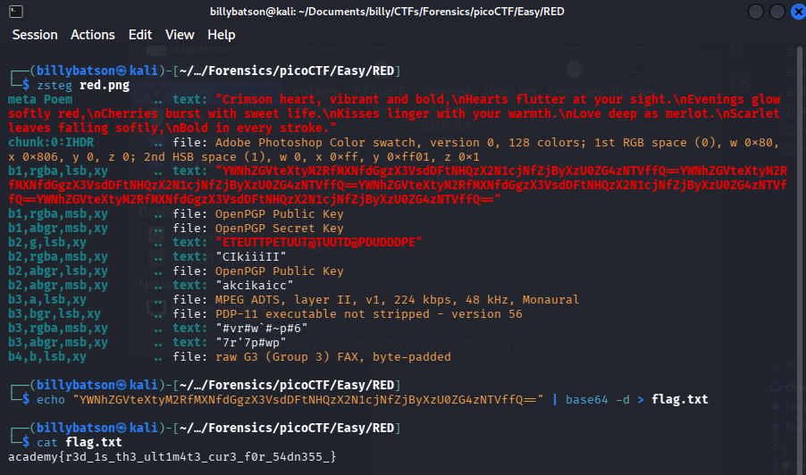

    # RED

### **📝 Task:** 
> RED, RED, RED, RED


### **📁 File provided:**
* `red.png` - A png image.


### **⌨️ Solution:**

For this challenge, we will use zsteg to detect hidden steganography in the image:

```bash
zsteg red.png
```

<p align ="center">
    
</p>

We see a familiar string the the base64 format, so we'll decode it and see what we get:  

```bash
echo "YWNhZGVteXtyM2RfMXNfdGgzX3VsdDFtNHQzX2N1cjNfZjByXzU0ZG4zNTVffQ==" | base64 -d > flag.txt
```

<p align ="center">
    
</p>

We get a flag and thats the answer to the challenge.


<details>
  <summary>Click to reveal spoiler</summary>
  <br>
  <div align="center">

  ### `academy{r3d_1s_th3_ult1m4t3_cur3_f0r_54dn355_}`

  </div>
</details>

---

### **💡 Key takeaways:**

Use zsteg to detect hidden steganography in images. It can help you find hidden messages or data that may not be visible to the naked eye.

Get comfortable recognizing Base64 encoded strings. They typically contain alphanumeric characters and often end with one or two = padding characters.