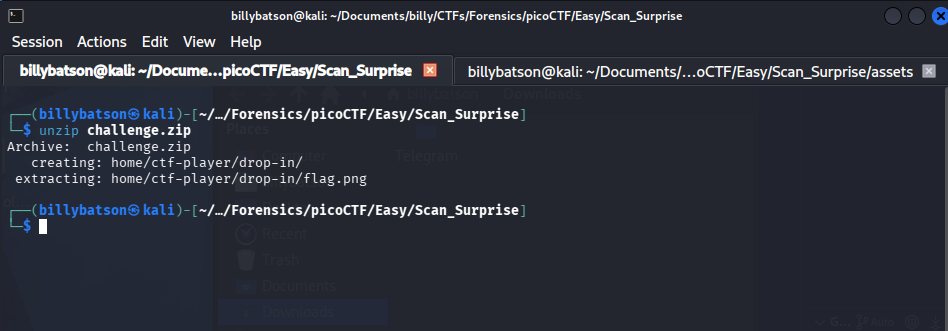
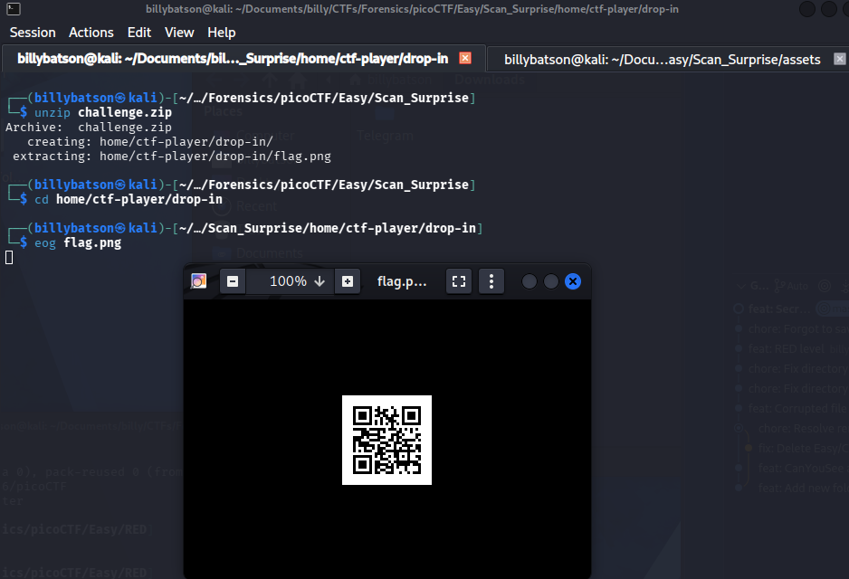
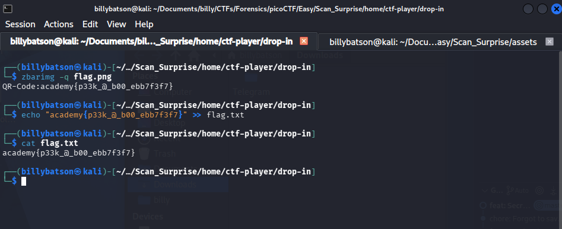

# Scan Surprise

### **📝 Task:** 
> TI've gotten bored of handing out flags as text. Wouldn't it be cool if they were an image instead?


### **📁 File provided:**
* `challenge.zip` - A zip file.


### **⌨️ Solution:**

We'll extract the zip file to see the contents:

```bash
unzip challenge.zip
```

<p align ="center">
    
</p>

We'll go and inspect the content, we see a png, so we'll inspect that:

```bash
eog flag.png
```

<p align ="center">
    
</p>

We get a QR code so we'll scan that:

```bash
zbarimg -q flag.png
```

<p align ="center">
    
</p>

It returns a flag so that is challenge complete.


<details>
  <summary>Click to reveal spoiler</summary>
  <br>
  <div align="center">

  ### `academy{p33k_@_b00_ebb7f3f7}`

  </div>
</details>

---

### **💡 Key takeaways:**

We can use `zbar-tools` to quickly scan QR codes using `zbarimg -q .png`


