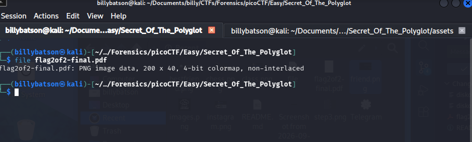
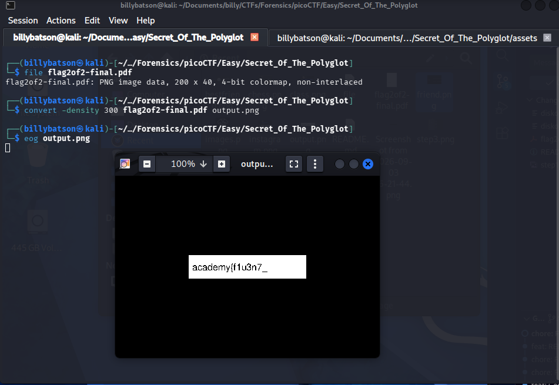
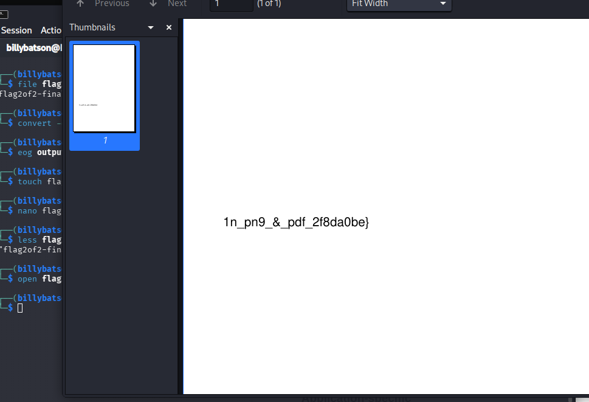

# CanYouSee

### **📝 Task:** 
> The Network Operations Center (NOC) of your local institution picked up a suspicious file, they're getting conflicting information on what type of file it is. They've brought you in as an external expert to examine the file. Can you extract all the information from this strange file?


### **📁 File provided:**
* `flag2of2-final.pdf` - A suspicious file


### **⌨️ Solution:**

First step always will be to check the file info:

```bash
file flag2of2-final.pdf
```

<p align ="center">
    
</p>

It says here that its a PNG image data, not a pdf, so what we'll do is convert it from a pdf to a png using ImageMagick:

```bash
convert -density 300 flag2of2-final.pdf output.png 
```

<p align ="center">
    
</p>

We get an image of half a flag which is `academy{f1u3n7_`, so we'll need to find the remaining half. Luckily for us the contents of the PDF looks like the other half:

<p align ="center">
    
</p>

It is `1n_pn9_&_pdf_2f8da0be`

We'll connect the two and then we'll have the final flag which is:


<details>
  <summary>Click to reveal spoiler</summary>
  <br>
  <div align="center">

  ### `academy{f1u3n7_1n_pn9_&_pdf_2f8da0be}`

  </div>
</details>

---

### **💡 Key takeaways:**

We can use `convert -density 300 <.pdf> <.png> to convert pdf to png.

