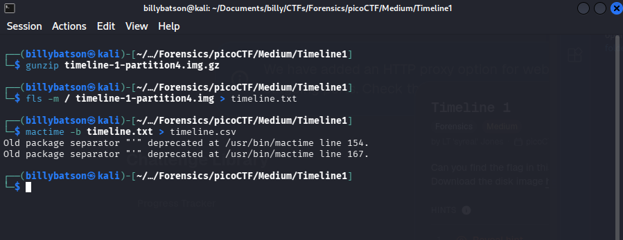
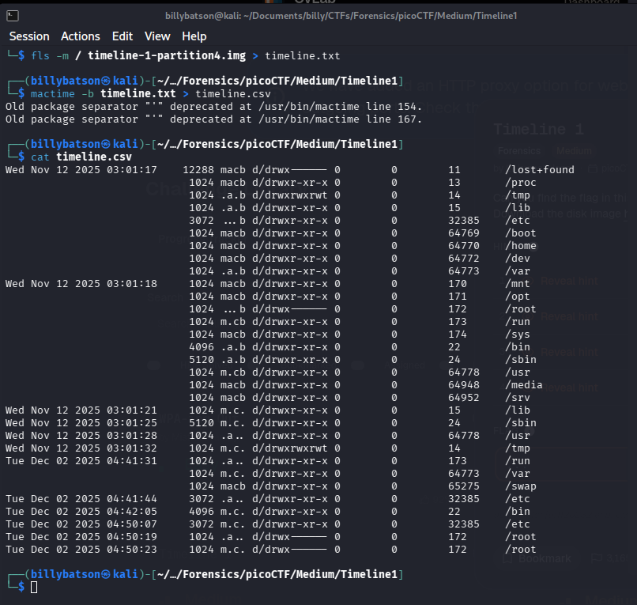
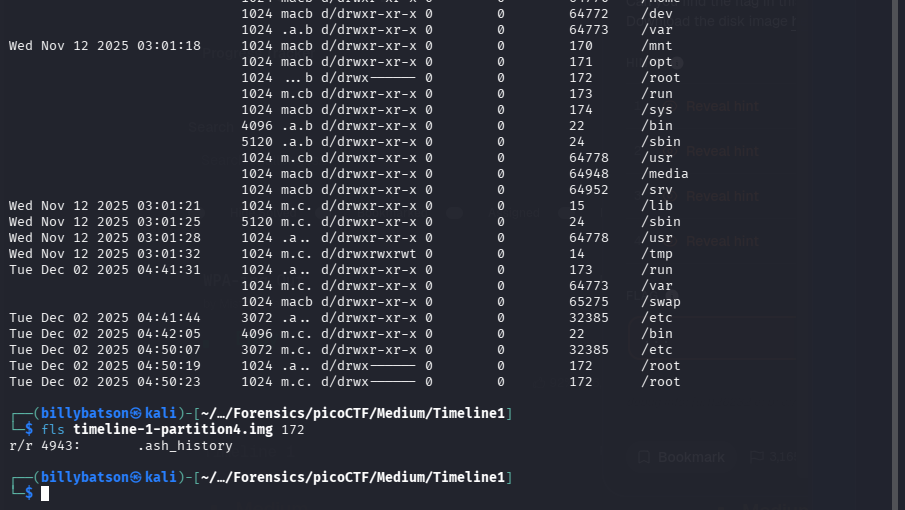
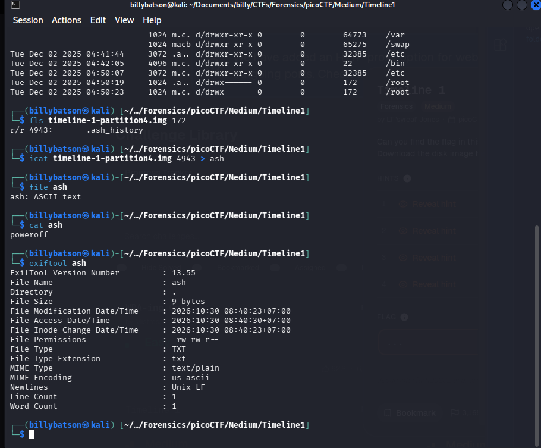
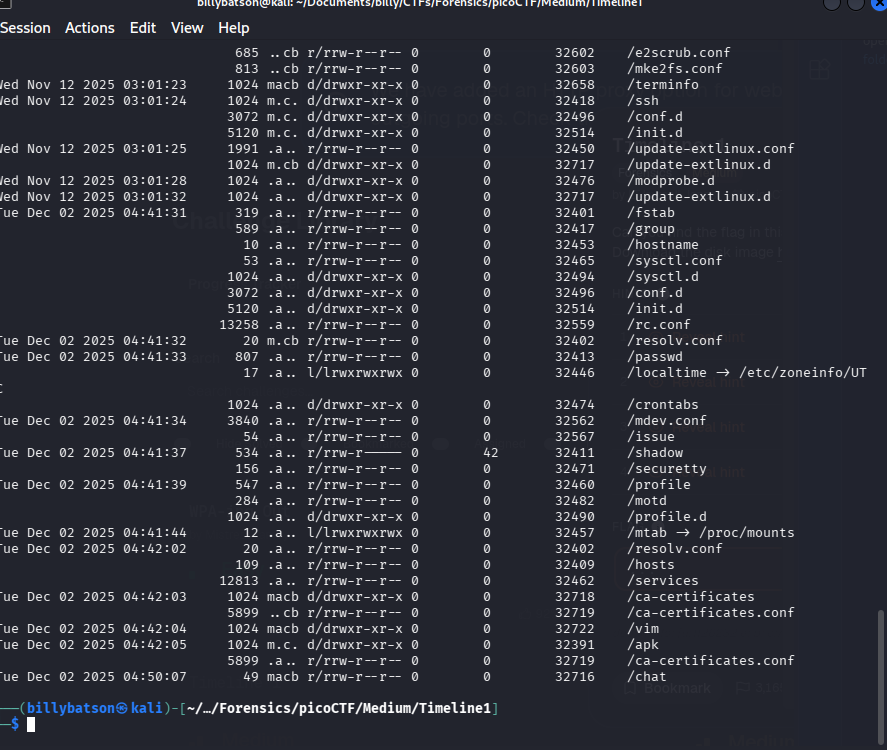
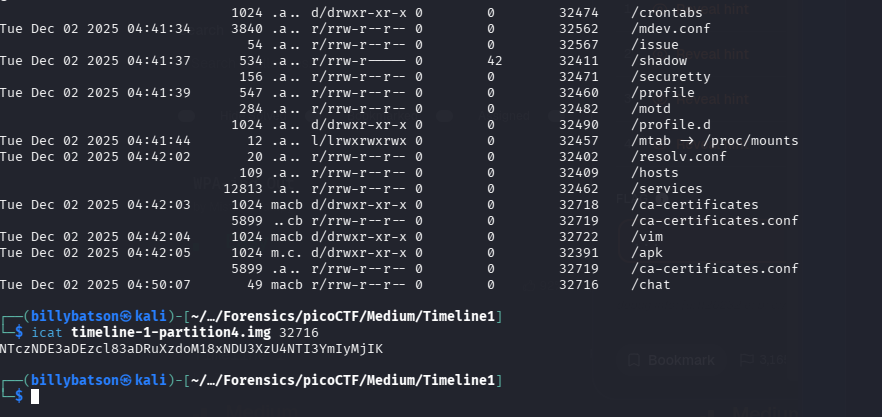
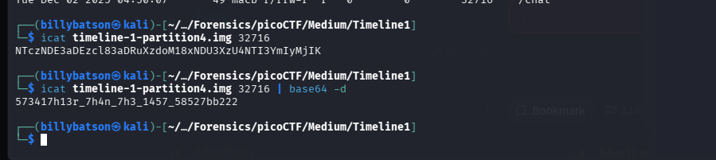
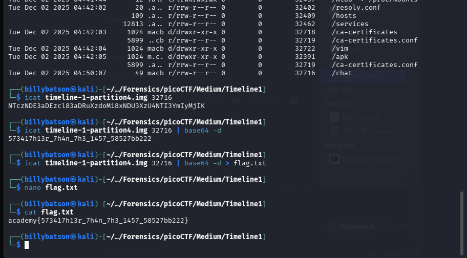

# Timeline1

### **📝 Task:** 
> Can you find the flag in this disk image? Wrap what you find in the academy{} flag format. 


### **📁 File provided:**
* `timeline-1-partition4.img.gz` - A disk image, gunzipped


### **⌨️ Solution:**

We'll first gunzip this disk image, view the contents and then sort it in a easy to read timeline: 

```bash
gunzip timeline-1-partition4.img.gz
fls -m / timeline-1-partition.img > timeline.txt
mactime -b timeline.txt > timeline.csv
```

<p align ="center">
    
</p>

View the timeline with all the details:

```bash
cat timeline.csv
```

<p align ="center">
    
</p>

We see that the last folder that was opened is /root (inode is 172) which is modified at `04:50:23`, so we'll begin by inspecting it:

```bash
fls timeline-1-partition4.img 172
```

<p align ="center">
    
</p>


We'll inspect this file around:  

```bash
icat timeline-1-partition4.img 4943 > ash
file ash
cat ash
exiftool ash
```

<p align ="center">
    
</p>


We see that its just ASCII text with nothing special in its metadata, so we'll check the second last folder that was opened which is /etc (inode number is 32385):

```bash
fls -m / timeline-1-partition4.img 32385 > etc.txt
mactime -b etc.txt > etc.csv
cat etc.csv
```

<p align ="center">
    
</p>


Okay now we look through all of these folders and we noticed something suspicious which is the `/chat` file, we'll inspect that first, and its also the latest file opened: 

```bash 
icat timeline-1-partition4.img 32716
```

<p align ="center">
    
</p>


We see an interesting but familiar string which is base64 encodings, so we'll decode it to see what we get: 

```bash
icat timeline-1-partition4.img 32716 | base64 -d 
```


<p align ="center">
    
</p>


We get a flag which we'll extract to our flag.txt:

```bash 
icat timeline-1-partition4.img 32716 | base64 -d > flag.txt
nano flag.txt
```


<p align ="center">
    
</p>


<details>
  <summary>Click to reveal spoiler</summary>
  <br>
  <div align="center">

  ### `academy{573417h13r_7h4n_7h3_1457_58527bb222}`

  </div>
</details>

---

### **💡 Key takeaways:**

When inspecting a disk image, check the latest files/folders opened, because its usually the most suspicious one.

Learn to navigate around a disk image with CLI.

Get comfortable recognizing Base64 encoded strings. 